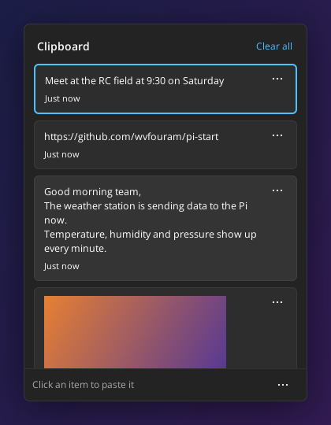
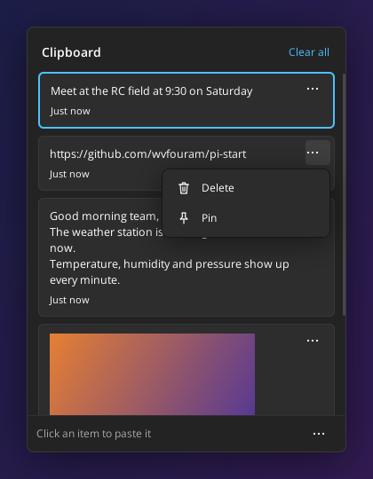

# pi-clipboard

A Windows 11 style Clipboard history app for the Raspberry Pi (built for the Pi 5, works on other Pis running Raspberry Pi OS). Native GTK app with the Windows 11 dark look, made to match [pi-explorer](https://github.com/wvfouram/pi-explorer) and [pi-taskmgr](https://github.com/wvfouram/pi-taskmgr).



## Features

- **Super+V** opens your clipboard history, just like Windows
- Keeps the last **25 things you copy**: text and pictures
- Click an item to **paste it** straight into the app you were using
- **Pin** items you use a lot (pinned items stay when you clear the list), **Delete** single items or **Clear all**
- Skips passwords copied from password managers
- Starts in the background when you log in; can be turned off from its menu



## Install

In a terminal on the Pi (as your normal user, not with sudo):

```
git clone https://github.com/wvfouram/pi-clipboard.git && bash pi-clipboard/install.sh
```

Copy something, then press **Super+V**.

To update later:

```
cd ~/pi-clipboard && git pull && bash install.sh
```

## Keyboard shortcuts

| Keys | Action |
|---|---|
| Super+V | Open / close clipboard history |
| Up / Down | Move between items |
| Enter | Paste the selected item |
| Delete | Delete the selected item |
| Esc | Close |

## Uninstall

```
bash pi-clipboard/uninstall.sh
```

## License

MIT
